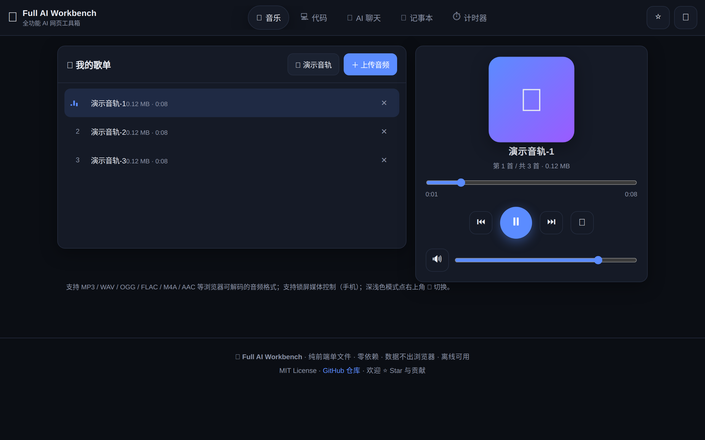
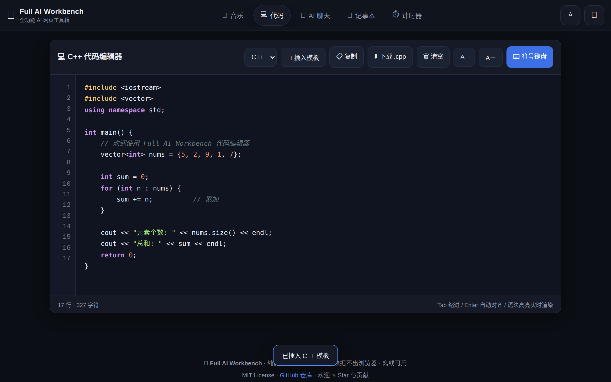
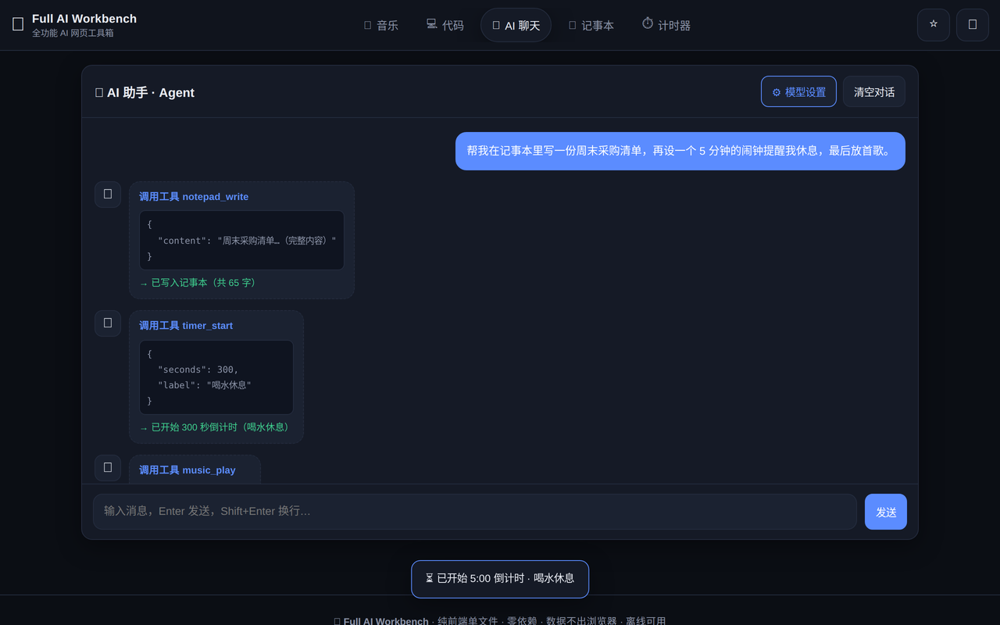
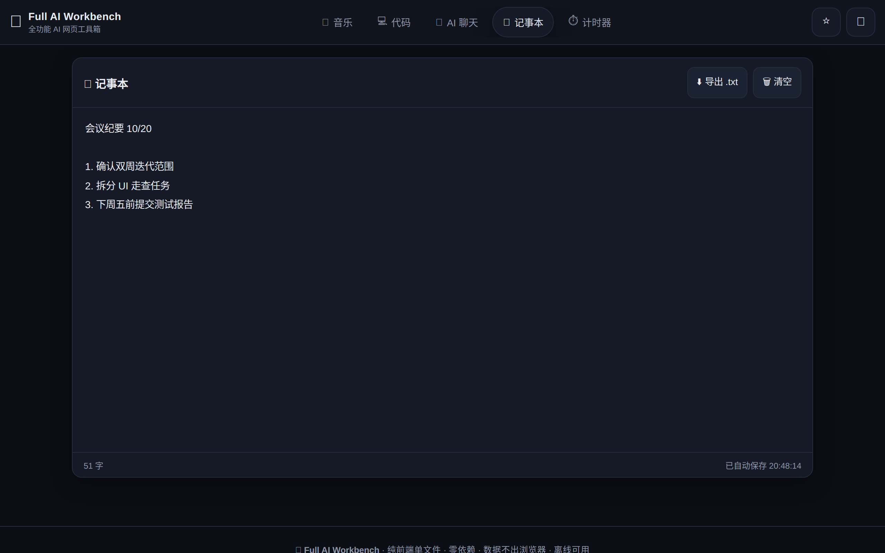
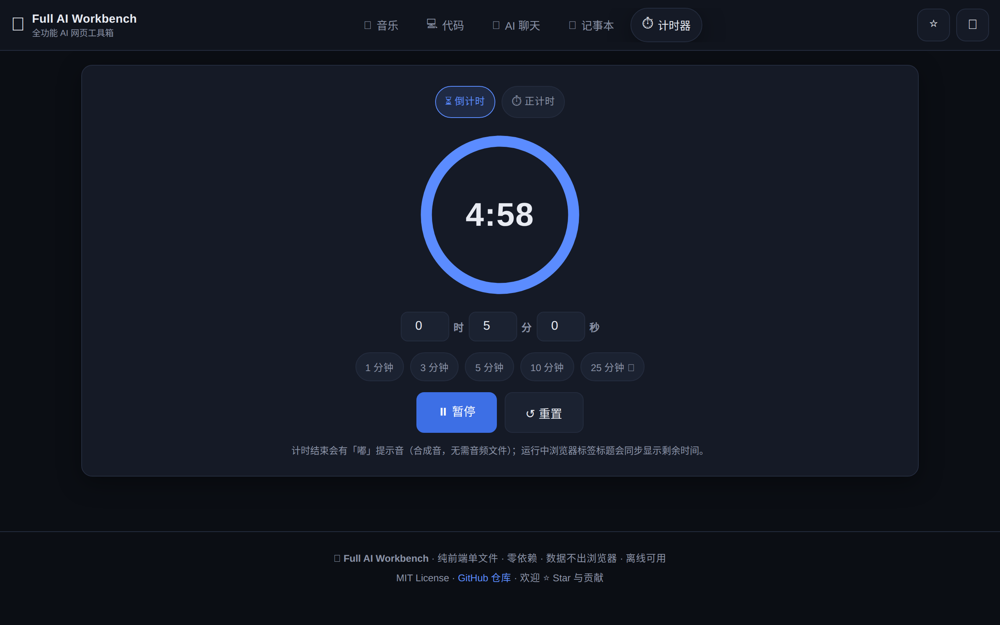
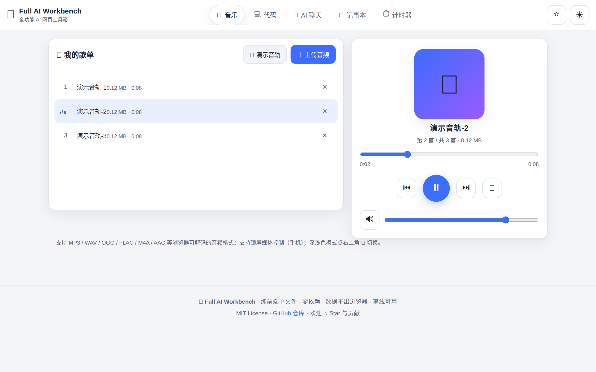

<div align="center">

# 🧰 tablet-full-ai-workbench

# Full AI Workbench · 全功能 AI 网页工具箱

**一个网页，装下整个工具箱** —— 音乐播放器、C++ 代码编辑器、AI 智能助手（Agent）、记事本、计时器。
纯浏览器本地运行：**无需安装、无需服务器、离线可用**；手机 / 安卓平板 / 电脑，打开即用。

*One web page, a full toolbox inside — music player, C++ code editor, AI chat agent, notepad and timer.
Everything runs locally in your browser: no install, no server, no account, and it works offline.
Use it on your phone, Android tablet, or desktop.*

[](https://andy-hub-byte.github.io/tablet-full-ai-workbench/)
[](docs/zh.md)
[](docs/en.md)


</div>

---

## 📸 截图 Screenshots

| 音乐播放器 · Music Player | 代码编辑器 · Code Editor |
|:--:|:--:|
|  |  |

| AI 助手（Agent）· AI Assistant | 记事本 · Notepad |
|:--:|:--:|
|  |  |

| 计时器 · Timer | 浅色模式 · Light Mode |
|:--:|:--:|
|  |  |

---

## ✨ 功能特性 Features

| 模块 Module | 亮点 Highlights |
|---|---|
| 🎵 **在线音乐播放器** | 上传本地音频（按钮 / 拖拽）、歌单管理、播放 / 暂停 / 上一首 / 下一首、**进度拖动**、音量调节、列表 / 单曲 / 随机播放、锁屏媒体控制；没有音频文件也能一键生成「演示音轨」 |
| 💻 **网页代码编辑器** | C++ / C **语法高亮**、行号、Tab 缩进与 Enter 自动对齐、**触屏符号键盘**（平板友好）、代码模板 / 复制 / 下载 .cpp、字体大小调节 |
| 🤖 **网页 AI 聊天（Agent）** | 接入任意 **OpenAI 兼容接口**（含本地 Ollama / LM Studio **离线模型**）、流式输出、原生 Function Calling + 本地模型回退协议；AI 能**直接操作工具箱**：写记事本、设倒计时、放音乐、切换界面、报时 |
| 📝 **记事本** | 输入自动保存（localStorage，刷新不丢）、字数统计、一键导出 .txt |
| ⏱️ **计时器** | 倒计时（1/3/5/10/25 分钟快捷预设）+ 正计时、SVG 进度环、结束提示音（WebAudio 实时合成，无需音频文件）、浏览器标签标题同步剩余时间 |
| 🌗 **深色 / 浅色模式** | 全站一键切换，自动记忆偏好 |

---

## 🚀 快速上手 Quick Start

### 方式一：在线使用（推荐）

直接打开演示链接，点开即用：

**👉 https://andy-hub-byte.github.io/tablet-full-ai-workbench/**

### 方式二：只下载一个文件

下载本仓库的 [`index.html`](index.html)，双击用浏览器打开即可 —— 不需要任何环境、任何依赖。

### 方式三：克隆仓库

```bash
git clone https://github.com/Andy-hub-byte/tablet-full-ai-workbench.git
cd tablet-full-ai-workbench

# 方式 A：直接双击 index.html
# 方式 B：起个本地静态服务（可选）
python3 -m http.server 8000   # 然后访问 http://localhost:8000
```

### AI 聊天 30 秒接入

1. 点右上角「⚙️ 模型设置」；
2. 选择预设：**本地 Ollama（离线）** / **LM Studio（离线）** / **OpenAI 兼容接口**，或填入你自己的接口；
3. 点「🔍 获取模型列表」→ 选择模型 → 「💾 保存设置」→ 开始对话。

本地离线示例（[Ollama](https://ollama.com)）：

```bash
ollama pull qwen2.5:3b        # 拉一个本地模型
ollama serve                  # 启动服务
# 然后：Base URL 填 http://localhost:11434/v1 ，API Key 随意填（如 ollama），模型填 qwen2.5:3b
```

没有模型也能玩：打开页面后按 `F12` 在控制台执行 `TFAW.seedChatDemo()`，即可预览 Agent 工具调用的完整效果。

---

## ❓ 常见问题 FAQ

### 📱 平板 / 触屏兼容性怎么样？

专门为触屏做了适配：

- 页面禁用双击缩放与手势冲突，按钮最小点击区域 ≥ 40px；
- 代码编辑器提供**符号键盘**（括号、分号、引号等一键插入），解决平板输入符号麻烦的问题；
- 布局自适应：手机单列、平板 / 电脑双列，导航栏可横向滑动；
- 计时器、播放器等高频操作都是大按钮，单手可操作。

> 在安卓平板上推荐使用 Chrome / Edge；iOS iPad 请用 Safari。两者均已验证可用。

### 🎵 为什么刷新后歌单空了？

出于安全与隐私，浏览器**不允许网页把本地文件保存到磁盘**。你的音频只在当前页面会话中播放，刷新后需要重新添加（点击「上传音频」或拖入文件即可，1 秒搞定）。记事本、主题、AI 设置等文本类数据会自动保存，刷新不丢失。

### 🔑 AI 聊天的 API Key 安全吗？

安全。Key 只存放在**你自己浏览器的 localStorage** 里，请求由你的浏览器直接发给模型接口，不经过任何中转服务器。清除浏览器数据即可彻底删除。

### 🤖 AI 能做什么？什么是「Agent 能力」？

内置 7 个工具，AI 可以调用它们直接操作这个工具箱：

| 工具 | 作用 |
|---|---|
| `notepad_write` / `notepad_read` | 写入 / 读取记事本 |
| `timer_start` | 开始倒计时 |
| `music_play` / `music_control` | 播放歌单 / 暂停、切歌 |
| `switch_app` | 切换到指定界面 |
| `get_current_time` | 报时 |

你可以直接说：「帮我在记事本里列一份购物清单，然后设个 5 分钟的闹钟」——AI 会依次调用工具完成，而不是只给你文字步骤。

### ⚠️ 常见报错与解决

| 报错 / 现象 | 原因 | 解决 |
|---|---|---|
| `Failed to fetch` / `NetworkError` | 接口地址写错、本地服务没启动，或接口不允许跨域（CORS） | 检查 Base URL；确认 Ollama / LM Studio 已启动；确认服务端允许浏览器跨域访问 |
| `HTTP 401` | API Key 无效或未填写 | 重新填写正确的 Key |
| `HTTP 404` | Base URL 路径不对 | OpenAI 兼容接口通常需要以 `/v1` 结尾，如 `http://localhost:11434/v1` |
| `Mixed Content` 报错，请求被拦截 | **https 页面不能访问 http 接口** | 用 GitHub Pages 演示页连本地模型会被浏览器拦截；请本地用 `http://localhost` 打开页面，或改用支持 https 的接口 |
| 音乐点击后没声音 / 播放失败 | 浏览器自动播放策略要求先有一次点击；或格式不受支持 | 先点击「播放」按钮再操作；换用 MP3 / WAV / M4A 等常见格式 |
| iOS 上不能自动播放 | Safari 自动播放限制 | 首次使用先点一下播放按钮（之后正常） |
| 记事本内容丢失 | 使用了无痕模式，或清理了浏览器数据 | 正常模式下内容会自动保存；重要内容请及时「导出 .txt」 |

---

## 🔒 隐私说明 Privacy

- 所有功能均在浏览器本地运行，**没有任何服务器、不上传任何文件**；
- 音乐文件仅通过浏览器本地对象 URL 播放；
- AI 请求由你的浏览器直接发向你配置的模型接口；
- 文本数据（记事本 / 设置 / 主题）仅存于 localStorage。

## 🛠️ 技术栈 Tech Stack

- 单个 `index.html`（约 76KB）：HTML5 + CSS3 + 原生 JavaScript，**零框架、零构建、零依赖、零外部请求**；
- 语法高亮、WAV 演示音轨、提示音均为**实时生成**，仓库内无大文件；
- 代码全中文注释，方便二次开发。

想改造？看这里：[📖 中文教程（含二次开发指南）](docs/zh.md) · [📘 English Guide](docs/en.md)

## 🤝 贡献 Contributing

欢迎 Issue 和 PR！提交前建议先开一个 Issue 讨论想法，避免重复劳动。代码风格：中文注释、原生 JS、不引依赖。

## 📄 开源协议 License

本项目采用 **MIT License** 开源。

> 原作者 / 初始维护者：**Andy-hub-byte**（Copyright © 2026 Andy-hub-byte）
>
> Fork 或二次开发时请保留上述署名与许可证声明，谢谢！

完整条款见 [LICENSE](LICENSE)。

---
---

# 🇬🇧 English Version

<div align="center">

# 🧰 Full AI Workbench

**One web page. A whole toolbox.** A music player, a C++ code editor, an AI chat agent, a notepad and a timer — all packed into a single HTML file that runs entirely in your browser.

No install. No server. No account. Works offline. Phone, Android tablet, or desktop — just open it and go.

[](https://andy-hub-byte.github.io/tablet-full-ai-workbench/)
[](docs/en.md)
[](docs/zh.md)

</div>

## 📸 Screenshots

| Music Player | Code Editor |
|:--:|:--:|
|  |  |

| AI Assistant (Agent) | Notepad |
|:--:|:--:|
|  |  |

| Timer | Light Mode |
|:--:|:--:|
|  |  |

## ✨ Features

| Module | Highlights |
|---|---|
| 🎵 **Music player** | Upload local audio (button or drag & drop), playlist management, play/pause/prev/next, **draggable progress bar**, volume control, list / single / shuffle modes, lock-screen media controls — plus a one-click "demo track" generator when you have no files handy |
| 💻 **Code editor** | C++ / C **syntax highlighting**, line numbers, Tab indent and auto-align on Enter, an **on-screen symbol keyboard** built for tablets, code template / copy / download, adjustable font size |
| 🤖 **AI chat with Agent skills** | Works with any **OpenAI-compatible API** (including local **Ollama / LM Studio** models that run fully offline), streaming responses, native function calling with a fallback protocol for local models — and the AI can actually *use* the toolbox: write notes, set timers, play music, switch screens, tell the time |
| 📝 **Notepad** | Auto-saves as you type (localStorage), character count, one-click .txt export |
| ⏱️ **Timer** | Countdown (1/3/5/10/25-min presets) and stopwatch, SVG progress ring, end-of-timer chime synthesized in real time (no audio files), remaining time mirrored in the browser tab title |
| 🌗 **Dark / light mode** | One tap to switch, preference remembered |

## 🚀 Quick Start

### Option 1: Use it online (easiest)

**👉 https://andy-hub-byte.github.io/tablet-full-ai-workbench/**

### Option 2: Download one file

Grab [`index.html`](index.html) from this repo and open it in your browser. That's it — no build step, no dependencies.

### Option 3: Clone the repo

```bash
git clone https://github.com/Andy-hub-byte/tablet-full-ai-workbench.git
cd tablet-full-ai-workbench
# Open index.html in your browser, or:
python3 -m http.server 8000   # then visit http://localhost:8000
```

### Connecting the AI in 30 seconds

1. Click **⚙️ Model settings** (top right of the chat panel);
2. Pick a preset — **local Ollama (offline)**, **LM Studio (offline)**, or any **OpenAI-compatible endpoint** — or type in your own;
3. Click **🔍 Fetch models**, choose a model, hit **💾 Save**, and start chatting.

Running a local model with [Ollama](https://ollama.com):

```bash
ollama pull qwen2.5:3b        # download a local model
ollama serve                  # start the server
# Then set Base URL to http://localhost:11434/v1, any API Key (e.g. "ollama"), model: qwen2.5:3b
```

No model yet? Open the page, press `F12`, and run `TFAW.seedChatDemo()` in the console to see the full agent tool-calling flow without any API key.

## ❓ FAQ

### 📱 Does it work well on tablets and touch screens?

Yes — touch was a first-class concern:

- Double-tap zoom and gesture conflicts are disabled; every tap target is at least 40px;
- The code editor ships with an **on-screen symbol keyboard** (brackets, semicols, quotes — one tap each), which makes typing code on a tablet far less painful;
- Responsive layout: single column on phones, two columns on tablets/desktops, and the tab bar scrolls horizontally;
- High-frequency controls (player, timer) use big, thumb-friendly buttons.

> Recommended browsers: Chrome or Edge on Android tablets, Safari on iPad. Both are tested.

### 🎵 Why is my playlist empty after a refresh?

For security and privacy reasons, browsers **don't let a web page save local files to disk**. Your audio only lives in the current tab session, so you'll need to re-add files after a refresh (one click or drag-and-drop). Text data — notes, settings, theme — persists automatically.

### 🔑 Is my API key safe?

Yes. The key is stored **only in your own browser's localStorage**. Requests go straight from your browser to the model endpoint you configured — there is no middle server. Clearing your browser data removes it completely.

### 🤖 What can the AI do? What are the "agent skills"?

Seven built-in tools the model can call to operate the toolbox directly:

| Tool | What it does |
|---|---|
| `notepad_write` / `notepad_read` | Write to / read from the notepad |
| `timer_start` | Start a countdown |
| `music_play` / `music_control` | Play from the playlist / pause, next, previous |
| `switch_app` | Jump to another module |
| `get_current_time` | Tell the current time |

Try: *"Add a grocery list to my notepad, then set a 5-minute timer."* The AI will call the tools in order instead of just describing the steps.

### ⚠️ Common errors and fixes

| Error / Symptom | Cause | Fix |
|---|---|---|
| `Failed to fetch` / `NetworkError` | Wrong Base URL, local service not running, or the endpoint blocks cross-origin (CORS) requests | Double-check the URL; make sure Ollama / LM Studio is running; make sure the endpoint allows browser CORS |
| `HTTP 401` | Missing or invalid API key | Enter a valid key |
| `HTTP 404` | Wrong Base URL path | OpenAI-compatible endpoints usually end with `/v1`, e.g. `http://localhost:11434/v1` |
| `Mixed Content` error, request blocked | An **https page cannot call an http endpoint** | The GitHub Pages demo can't reach a local model — open the page over `http://localhost` instead, or use an https endpoint |
| No sound after clicking play | Browser autoplay policy, or unsupported codec | Click play once first; use common formats like MP3 / WAV / M4A |
| Audio won't autoplay on iOS | Safari autoplay restrictions | Tap play once — afterwards it behaves normally |
| Notepad content disappeared | Private/incognito mode, or cleared browser data | Content auto-saves in normal mode; use "Export .txt" for anything important |

## 🔒 Privacy

- Everything runs locally in your browser. **There is no server, and no file is ever uploaded**;
- Audio files are played via local object URLs only;
- AI requests go directly from your browser to the endpoint you configure;
- Text data (notes, settings, theme) lives in localStorage only.

## 🛠️ Tech Stack

- A single `index.html` (~76KB): HTML5 + CSS3 + vanilla JavaScript — **no frameworks, no build step, no dependencies, no external requests**;
- Syntax highlighting, the demo WAV track and the timer chime are all **generated at runtime**, so the repo contains no heavy assets;
- All code comments are in Chinese (the project's primary audience), which makes it easy to fork and tweak.

Want to customize? See the [English Guide](docs/en.md) (includes a developer's section) or the [中文教程](docs/zh.md).

## 🤝 Contributing

Issues and PRs are welcome! For anything non-trivial, please open an issue first so we can discuss the approach. House style: Chinese comments, vanilla JS, no new dependencies.

## 📄 License

Released under the **MIT License**.

> Original author / maintainer: **Andy-hub-byte** (Copyright © 2026 Andy-hub-byte)
>
> If you fork or build on this project, please keep the attribution and license notice above. Thank you!

See [LICENSE](LICENSE) for the full text.

---

<div align="center">

## ⭐ 支持项目 Support the project

**中文**：如果你觉得这个工具箱好用，欢迎点 ⭐ **Star** 支持项目！

**English**: If you find this tool useful, please give a ⭐ **Star** to support this project!

<a href="https://github.com/Andy-hub-byte/tablet-full-ai-workbench/stargazers">
  
</a>

</div>
